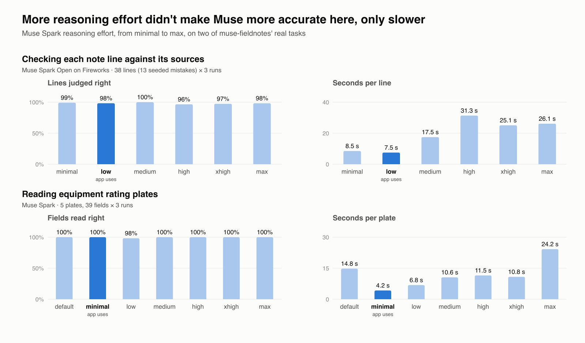

# muse-fieldnotes

Close-out notes for HVAC technicians that check themselves. A technician's photos, voice notes and texts from a job become the note the office bills from: every line cites the evidence it rests on, a second model checks every line, and when something is missing or doesn't add up, the agent asks the technician on their phone instead of guessing.

Built for the Meta Global AI Developer Hackathon (startup track, Oct 26 – Nov 4, 2026) on Muse Spark, Muse Spark Open, SAM 3.1 and Muse Voice Transcribe.

- **Live:** https://muse-fieldnotes.vercel.app (reading jobs and notes is open; running the agent needs the demo passcode)
- **Demo video:** _link added at submission_

## What it catches

A technician's voice note says "topped off with 410A". Asked for the condenser's make and model, they send a photo of the rating plate, and Muse Spark reads it: an R-454B heat pump. Each line of a note built from those sources would be true to what it cites, so a line-by-line verifier would pass it. A check in code compares the refrigerant across every source and refuses the note. The agent goes back to the technician, naming the plate's refrigerant in the question, and the note the office signs off records what was actually added. Putting R-410A into an R-454B system is a real and costly mistake; the note is where the office should find out.

This happened in a live test on the deployed site with real equipment photos.

## How it works

1. **Sources.** A job is a thread of sources: the dispatch record, photos, voice notes (transcribed by Muse Voice Transcribe), texts and the shop's price book.
2. **The close-out agent.** Muse Spark runs a loop on the Meta Responses API. Each turn it says what it is doing and calls exactly one tool. The checks live inside the tools, so the agent cannot skip them (`src/lib/agent/`).
3. **The technician answers from their phone.** When the agent has questions, the office page shows a QR code. The technician scans it and answers on a mobile page with no app and no login, by typing or by taking photos. Photos are re-encoded with their metadata stripped. Whoever sends first, the office or the technician, wins.
4. **Every line is checked.** Code checks run first; then Muse Spark Open checks each line against only the sources it cites. Clicking a citation on a photo shows SAM 3.1's highlight of the exact part the line rests on.
5. **The office signs off.** Approve, or send it back with notes. A sent-back note returns to the agent, which can revise it or ask the technician again.

| Tool | What it does | Checks inside it | On failure |
|---|---|---|---|
| `read_nameplates` | Reads rating plates and part labels (e.g. a capacitor's MFD) in photos into citable sources | | |
| `set_checklist` | One entry per item of the shop's checklist for the call type: found (cited), ask, or not applicable | Code: every shop item covered, cited sources exist, numbers appear in them, refrigerant matches the plates. Then Muse Spark Open judges each entry against all sources | Refused with the problems; after 3 refusals accepted, with the problems kept for the office |
| `ask_tech` | Asks the technician about items marked ask | Item is marked ask, not already asked, at most 4 questions and 2 rounds | The run pauses until the technician answers; answers and photos become sources |
| `submit_note` | Submits the cited note | Code: every found or answered checklist item is covered by a citing line; numbers in each line appear in its cited sources; a refrigerant conflict is either asked about or stated with the plate cited. Then Muse Spark Open checks each line | Refused with the problems; after 3 refusals escalated to the office |

The shop's checklist (`src/lib/agent/checklist.ts`) is the ground truth, set by the shop, not the model. A one-pass close-out (no questions) is kept as a fast mode.

## Meta models

| Model | Job | Where |
|---|---|---|
| Muse Spark (`muse-spark-1.3`) | Runs the agent; reads rating plates and part labels | Meta Model API (Responses and Chat Completions) |
| Muse Spark Open (`muse-spark-open-1026`) | Verifies every line and judges the checklist: a different model on different infrastructure from the one that wrote the note | Baseten, failing over to Fireworks, then Modal |
| SAM 3.1 | Highlights the cited part of a photo | Meta Model API |
| Muse Voice Transcribe | Transcribes the technician's voice notes | Meta Model API |

## Measured on our own tasks

We measured reasoning effort on this app's two model-heavy tasks instead of assuming the default. Each setting ran 3 times.



- **Verifier** (Muse Spark Open on Fireworks; 38 lines from two jobs, 13 of them seeded mistakes): every effort level caught all 13 seeded mistakes. The app runs at `low`: 98.2% of verdicts exactly right at 7.5 s per line, against 31.3 s at `high` with no gain.
- **Plate reader** (Muse Spark; 5 plates, 39 hand-transcribed fields): `minimal` read 100% of fields right at 4.2 s per plate, against 14.8 s at the default. The app now reads plates at `minimal`.

Rerun with `node scripts/eval-verifier.mjs` and `node scripts/eval-nameplates.mjs` while the app runs locally (`APP_URL` if it isn't on port 3000), and redraw the chart with `node scripts/chart-effort.mjs`. Raw results are in `evals/results/`.

## Built to hold up in production

- **Deployed on Vercel**, with agent runs, caches and uploads in Upstash Redis, so every server instance sees the same run while the agent works, the page polls and answers arrive.
- **Verifier failover:** Baseten → Fireworks → Modal, with a timeout per host. A line no host can check is marked unverified rather than blocking the note.
- **Bounded agent:** a turn limit per stretch, a stop before the platform's time limit, and refusal budgets that hand the note to the office instead of looping.
- **Access:** anyone can read jobs and notes; running the agent, answering, signing off and computing highlights need the demo passcode. The technician's link is a random token that only works while that run is waiting for answers, and photo uploads through it are rate-limited.
- **Caching:** model results (plate readings, verdicts, highlights) are cached by a hash of their inputs, so re-running a job costs nothing for what hasn't changed.

## Data

No real customers, technicians, job numbers or addresses; the job records are invented. job-003's photos are real equipment from our own shop, with serial numbers, barcodes and QR codes redacted and photo metadata stripped, and its voice note is the founder's own voice, used with permission. API keys live in `.env`, which is git-ignored.

## Run it locally

```bash
npm install
cp .env.example .env   # add a Meta Model API key, and at least one Muse Spark Open host
npm run dev
```

Locally, runs and caches are files under `.cache/`, and no passcode is needed. `npm run typecheck`, `npm run lint` and `npm run check:fixtures` check the code and the fixture jobs.

## Built during the hackathon

Everything in this repo was written during the event. Before kickoff the repo held only a planning README (Oct 23). The app, the agent, the technician's phone flow, the checks and the evals were built Oct 26 – Nov 4; the merged pull requests show the order.

## Next

- The design-partner shop's real close-out checklist in place of the stand-in.
- Hands-free capture from Ray-Ban Meta glasses into the job thread.
- An advisor and homeowner view for recommendations, where every claim shows the real photo behind it.
